# Desafio do PicPay Simplificado

Essa é minha resolução do [desafio backend proposto pelo PicPay](https://github.com/PicPay/picpay-desafio-backend):

- O PicPay Simplificado é uma plataforma de pagamentos apenas com funcionalidades básicas.
- Nela é possível depositar e realizar transferências de dinheiro entre usuários.
- Temos 2 tipos de usuários, Clientes e Lojistas, ambos têm carteira com dinheiro e podem realizar transferências.
- A realização de transferências depende de um serviço autorizador externo, que determina se a operação pode acontecer ou não.
- Em caso de sucesso da transferência, o recebedor deve ser notificado da transação, através de um serviço externo de notificação.
- Ambos os serviços externos podem estar estar indisponíveis no momento que são chamados (precisamos tratar esses casos no código).

Temos 3 pontos principais neste projeto:

- A consistência dos dados é fundamental (o dinheiro não pode sumir nem surgir do nada)
- A segurança dos dados também é fundamental (apenas você pode transferir/consultar seu dinheiro)
- O envio de notificações deve ser feito de maneira assíncrona, tornando o sistema resiliente a falhas

Resumo do que você vai encontrar aqui:

- API C#/.Net + documentação com Scalar
- Testes automatizados
- CI/CD com o GitHub Actions
- Deploy no Railway (Api + Postgres + Worker)
- Processamento assíncrono de eventos e tarefas em background
- Concorrência e paralelismo + consistência financeira

## 0️⃣ Sumário

- 1️⃣ Regras de Negócio
- 2️⃣ Arquitetura
- 3️⃣ Casos de Uso
- 4️⃣ Processamento Assíncrono
- 5️⃣ Documentação da API
- 6️⃣ Deploy
- 7️⃣ Referências

## 1️⃣ Regras de Negócio

- Existem dois tipos de usuários no sistema: Clientes e Lojistas

- Usuários possuem Nome, Documento, E-mail e Senha:
    - Documentos e e-mails devem ser únicos no sistema
    - O sistema deve permitir apenas um cadastro com o mesmo Documento ou E-mail

- Clientes podem realizar transferências para Lojistas ou outros Clientes

- Lojistas só recebem transferências, não enviam

- Antes de finalizar a transferência, deve-se consultar um serviço autorizador externo (https://util.devi.tools/api/v2/authorize)

- Após a transferência:
    - O cliente ou lojista precisa receber uma notificação (email, sms) enviada por um serviço externo (https://util.devi.tools/api/v1/notify)
    - Eventualmente este serviço pode estar indisponível/instável

> 🆙 As regras a seguir foram adicionadas por mim, para deixar o projeto mais desafiador

- A API terá autenticação e autorização:
    - Endpoins para cadastro de usuários e para realização de login

- A notificação será enviada de maneira assíncrona:
    - Teremos um evento de Transferência Realizada, que vai disparar uma tarefa em background para enviar a notificação
    - Vamos usar uma política de retentativa simples, caso o serviço externo retorne algum erro

- Bônus de Boas-Vindas:
    - Todo Cliente que se cadastrar no PicPay, receberá um bônus no valor de R$ 10,00
    - O valor desse bônus sairá da carteira do próprio PicPay

- Cliente deve poder acessar:
    - Seu saldo atual
    - Extrato com todas as suas transações
    - Listagem com todas as suas notificações

- Lojista deve poder acessar:
    - Seu saldo atual
    - Extrato com todas as suas transações
    - Listagem com todas as suas notificações

## 2️⃣ Arquitetura

O sistema é formado por 4 componentes:
- API (ASP.NET)
- Worker (Hangfire)
- Vendors (serviços externos de autorização e notificação)
- Banco (PostgreSQL)

  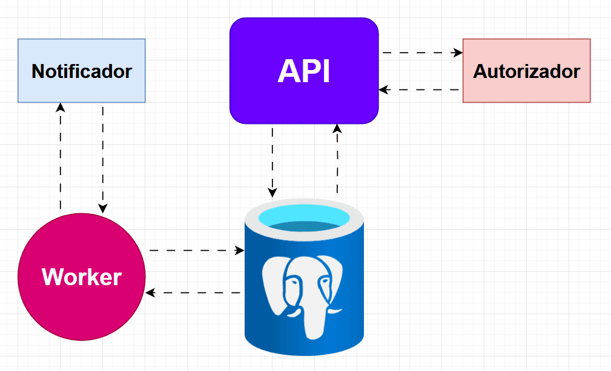

A API é responsável por executar a maioria dos fluxos de negócio, como cadastro, login e transferência.

Durante o processamento de um request pela API, pode haver a emissão de algum evento de domínio.
Esse evento é então processado pelo Worker em um processo separado, de forma que a API entrega a resposta pro cliente o mais rápido possível.
O Worker então processa o evento, disparando alguma tarefa em background, como o envio da notificação de transferência recebida, por exemplo.

O banco é bem simples, poucas tabelas já dão conta de todas as funcionalidades:

  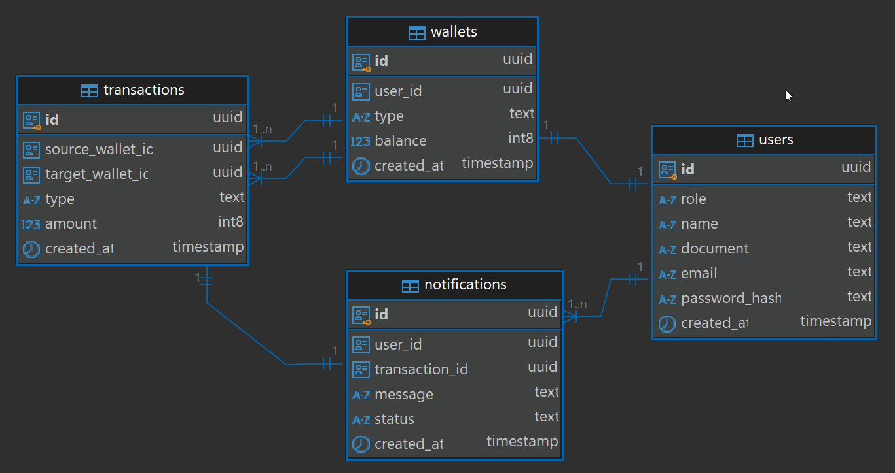

Para os Vendors, criei uma API própria que vai servir de "mock" nos ambientes de desenvolvimento e testes.
Essa API possui o endpoint do autorizador (/api/v2/authorize) e o endpoint do notificador (/api/v1/notify).
Dessa forma, basta apontar para a url da API de Vendors nos testes. Em prod, basta usar as urls fornecidas pela PicPay.

Também adicionei certa lógica dentro desses endpoints, como por exemplo, sempre desautorizar transferências no valor de R$ 6,66.

## 3️⃣ Casos de Uso

A seguir temos todos os casos de uso do sistema.
Cada um deles possui um respectivo teste automatizado validando seu comportamento.
Coloquei prints de código em alguns a título de exemplo.

### Cadastro de Clientes
- Deve cadastrar com sucesso quando todos os dados forem válidos
- Não deve cadastrar quando o CPF for inválido
- Não deve cadastrar quando o email for inválido
- Não deve cadastrar quando a senha for fraca
- Não deve cadastrar quando o CPF já estiver vinculado com outro cliente
- Não deve cadastrar quando o email já estiver vinculado com outro cliente
- Dois requests com os mesmos CPF e email feitos no mesmo instante devem cadastrar apenas um usuário
    - Esse cenário é mostrado a seguir, onde disparo dois requests simultâneos com os mesmos dados, a fim de validar que o sistema vai cadastrar apenas um usuário e retornar erro no outro request.

  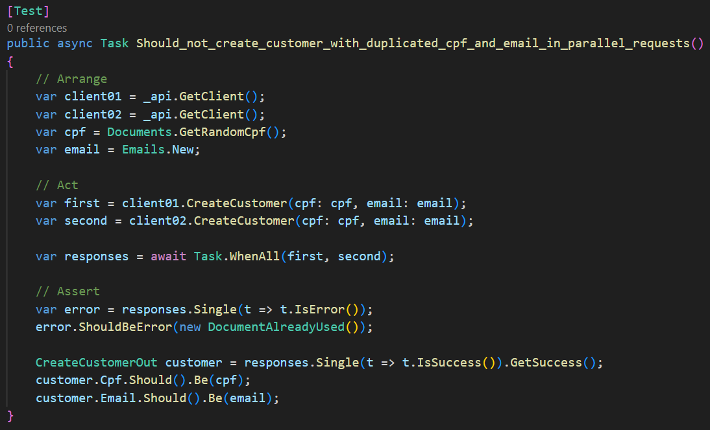

### Cadastro de Lojistas
- Deve cadastrar com sucesso quando todos os dados forem válidos
- Não deve cadastrar quando o CNPJ for inválido
- Não deve cadastrar quando o email for inválido
- Não deve cadastrar quando a senha for fraca
- Não deve cadastrar quando o CNPJ já estiver vinculado com outro lojista
- Não deve cadastrar quando o email já estiver vinculado com outro lojista
- Dois requests com os mesmos CNPJ e email feitos no mesmo instante devem cadastrar apenas um usuário

### Login
- Deve conseguir logar tanto como cliente quanto como lojista
- Não deve logar quando o usuário não existir
- Não deve logar quando a senha estiver incorreta

### Bônus de Boas-Vindas
- Clientes novos devem receber um bônus de R$ 10,00
- Lojistas não devem receber esse bônus
- A criação de clientes em paralelo deve manter o saldo de todas as carteiras consistente (soma zero)

  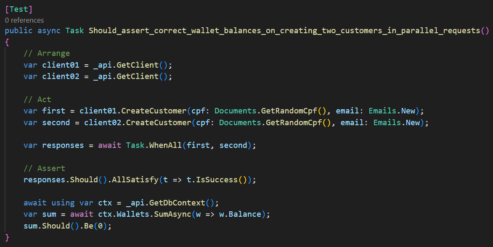

- Uma notificação deve ser enviada para o cliente com a menssagem: "Bônus de Boas-Vindas no valor de R$ 10,00"

  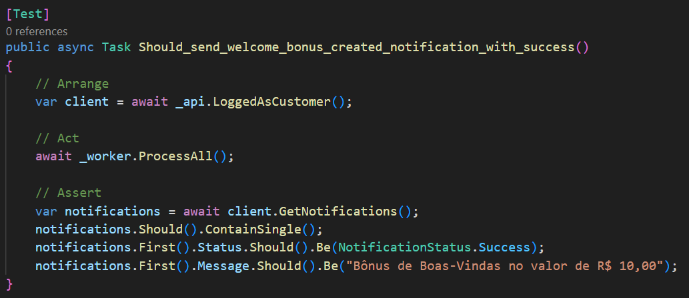

### Transferência de dinheiro
- Cliente pode transferir para um lojista

- Cliente pode transferir para outro cliente

- Não pode transferir valor <= 0

- Nâo pode transferir pra uma carteira inexistente

- Não pode transferir para si próprio

- Não pode transferir sem saldo suficiente

- Não pode transferir caso seja não autorizado
    - Nesse caso configurei para o Autorizador retornar "false" quando receber o valor de R$ 6,66

  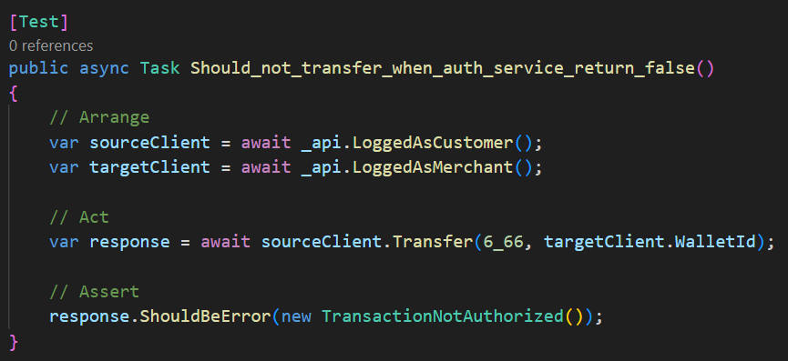

- Não pode transferir caso o autorizador esteja fora do ar
    - Nesse caso configurei para o Autorizador retornar "504 Gateway Timeout" quando receber o valor de R$ 5,04

  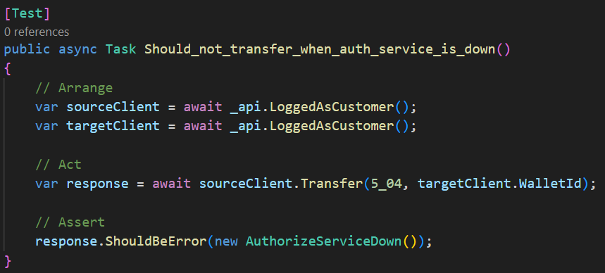

- Não deve transferir em paralelo, gastando mais que o saldo
    - Tenho R$ 10,00 de saldo, não posso realizar duas transferências de R$ 8,00 ao mesmo tempo
    - Apenas uma delas deve ser feita, a outra deve retornar erro
    - Se forem duas de R$ 4,00 ambas devem ser realizadas com sucesso

  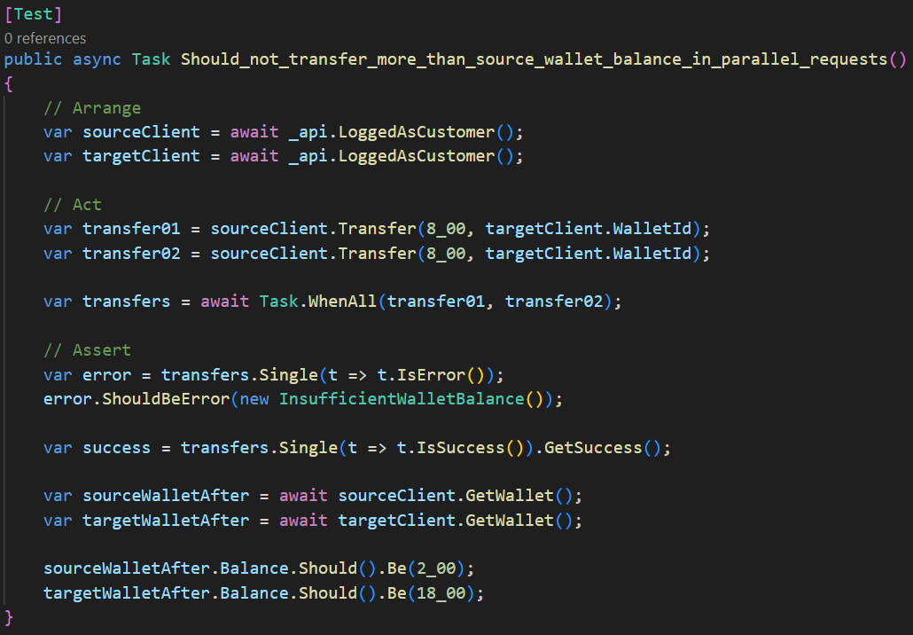

- Quem recebe duas transferências ao mesmo tempo deve acabar com o saldo correto
    - Um lojista recebendo vários pagamentos de maneira simultânea deve se manter com saldo consistente
    - O lojista possui saldo de R$ 5,00
    - Dois clientes transferem R$ 8,00 cada pro lojista ao mesmo tempo
    - O saldo final do lojista deve ser de R$ 21,00

  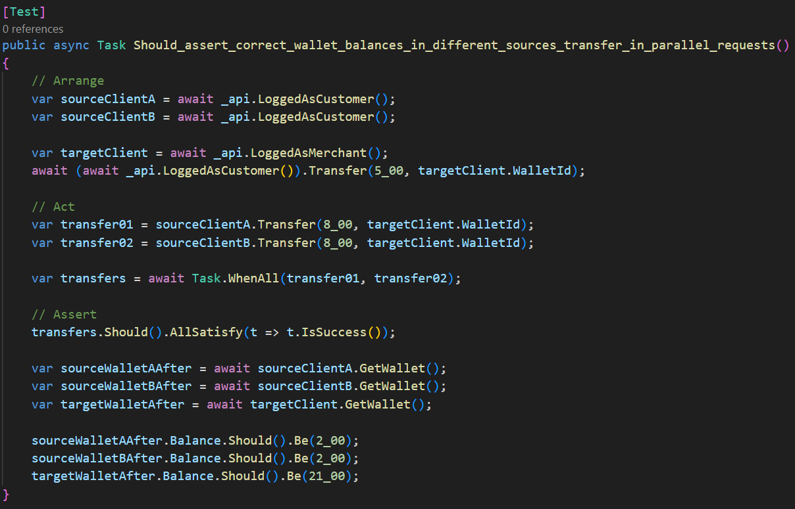

- Quem enviar pra X e receber de Y ao mesmo tempo deve acabar com o saldo correto
    - Maria possui R$ 5,00 de saldo, Zezinho possui R$ 8,00 e o lojista Gilbirdelson possui R$ 10,00
    - Maria envia R$ 2,00 pra Gilbirdelson e, no exato mesmo instante, Zezinho envia R$ 6,00 pra Maria
    - Maria deve terminar com saldo de R$ 9,00
    - Gilbirdelson com R$ 12,00
    - Zezinho com R$ 2,00

  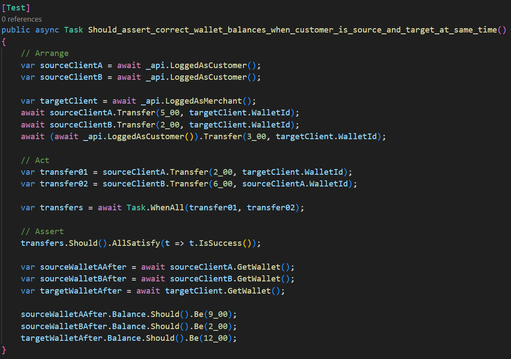

- Quem enviar pra X e receber de X ao mesmo tempo deve acabar com o saldo correto
    - Maria possui R$ 10,00 de saldo e Zezinho possui R$ 10,00
    - Maria envia R$ 6,00 pra Zezinho e, no exato mesmo instante, Zezinho envia R$ 2,00 pra Maria
    - Maria deve terminar com saldo de R$ 6,00 e Zezinho com R$ 14,00
    - Se não tratado, isso pode gerar um deadlock no banco de dados

  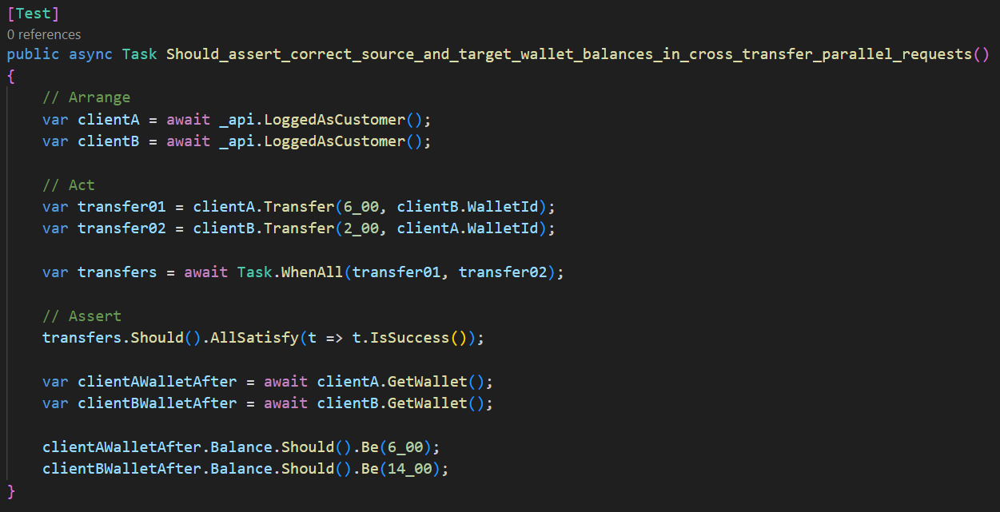

- Ao final, o recebedor (cliente ou lojista) deve ser notificado da transação via serviço externo
    - O status igual a "Success" indica que o serviço notificador retornou ok no momento que foi chamado

  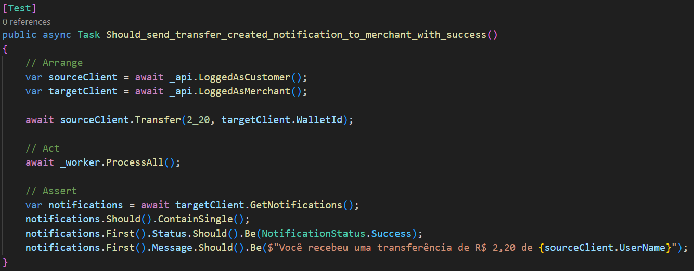

- Caso o recebedor (cliente ou lojista) não seja notificado pelo serviço externo, a notificação ainda deve ficar acessível no endpoint de notificações
    - Criei uma política de retentativa onde o endpoint do notificador é chamado até 3 vezes, com intervalo de 1 segundo entre as chamadas
    - Caso todas retornem erro, a notificação é salva no banco de dados como não enviada (status = "Failed")
    - Seria possível criar outra política que tenta enviar novamente a notificação após um tempo também

  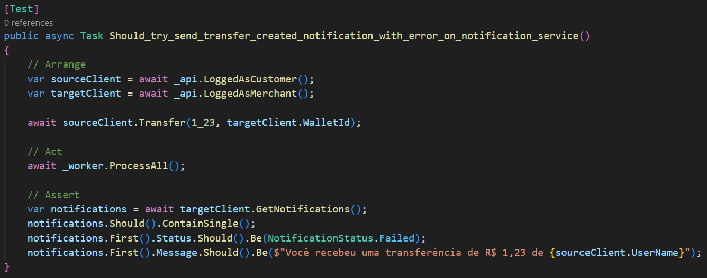

### Notificações do Cliente
- Listar todas as notificações do cliente, ordenadas pela mais recente

  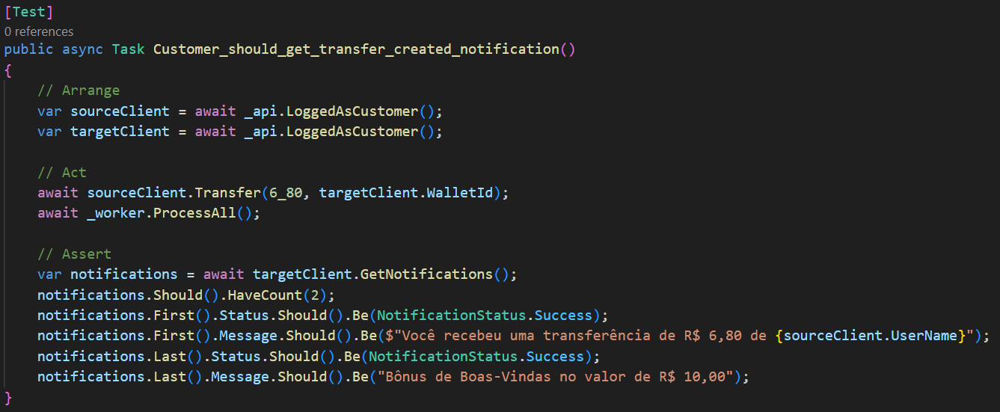

### Notificações do Lojista
- Listar todas as notificações do lojista, ordenadas pela mais recente

  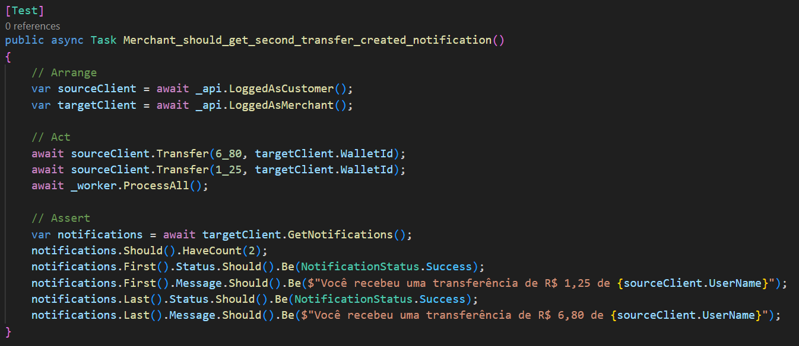

### Extrato de Transações do Cliente
- Listar todas as transações do cliente, ordenadas pela mais recente

  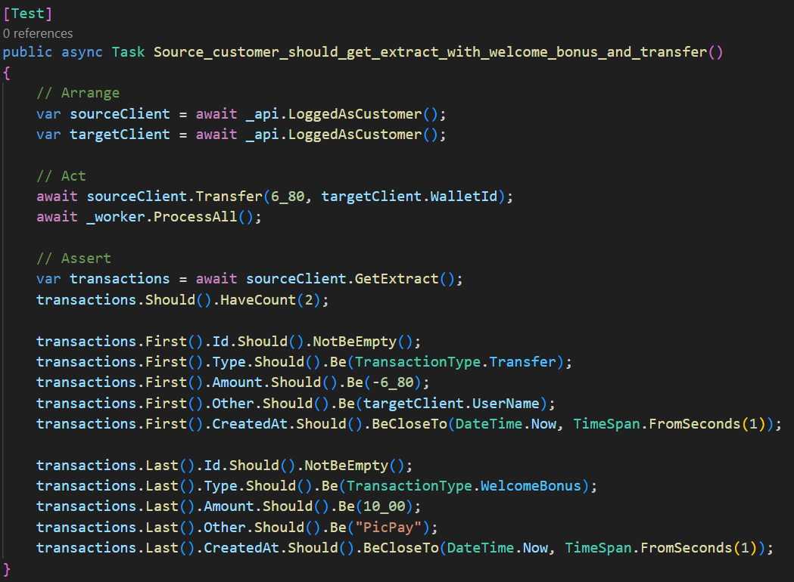

### Extrato de Transações do Lojista
- Listar todas as transações do lojista, ordenadas pela mais recente

  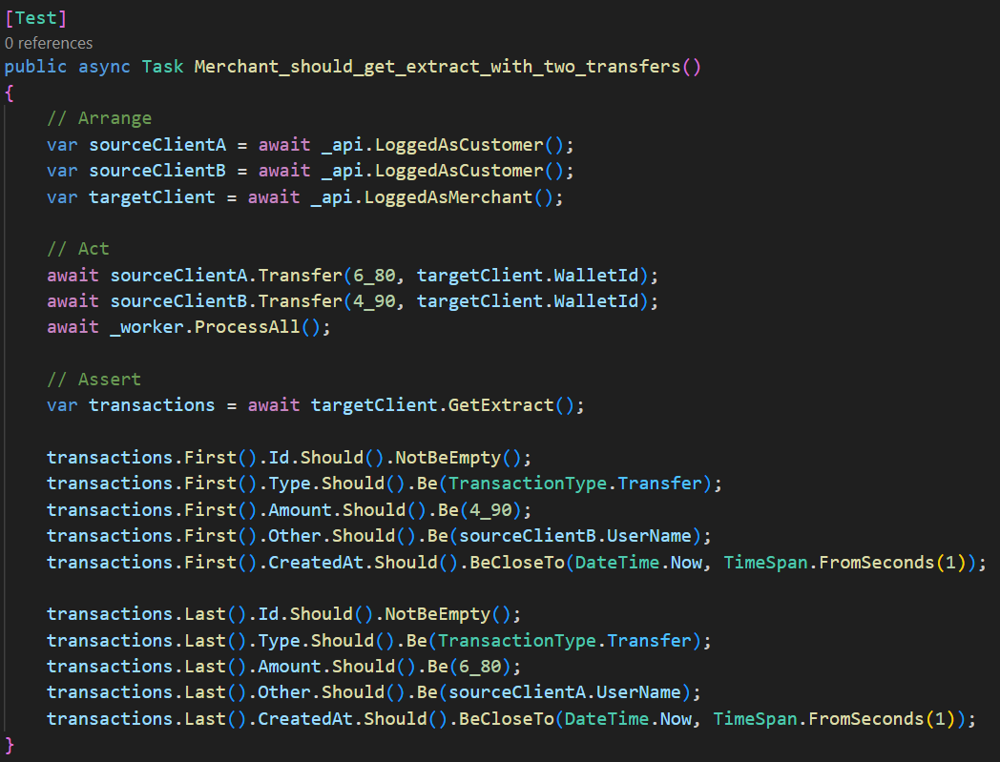

## 4️⃣ Processamento Assíncrono

O Processamente Assíncrono de eventos e tarefas é realizado pelo Worker. Existem duas tabelas no banco para o controle dessas operações:

  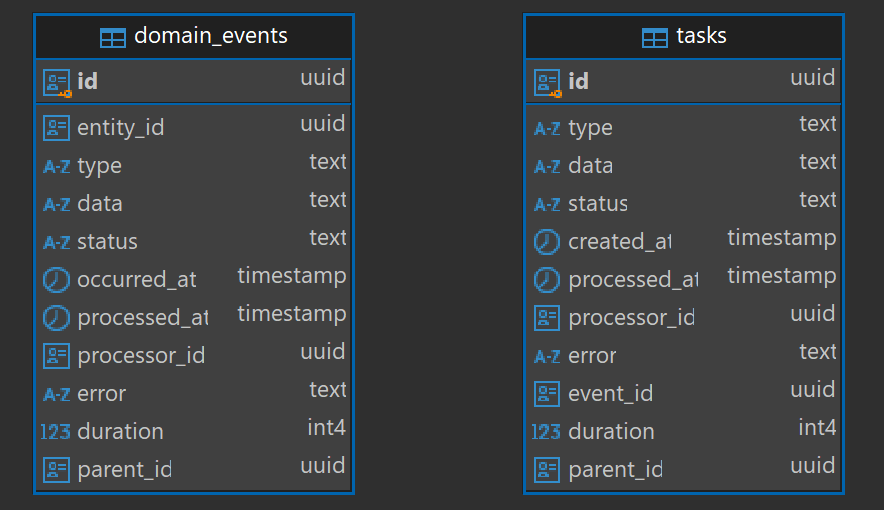

O Worker possui dois Listeners, um para eventos e outro para tasks.
Esses Listeners utilizam a feature de LISTEN/NOTIFY do Postgres para escutar quando um novo evento ou uma nova tarefa são inseridos nas tabelas.
Dessa forma não preciso ficar fazendo pooling no banco para buscar registros pendentes de processamento.

Quando um Listener é notificado, dispara um Processor que é responsável por carregar os registros pendentes do banco e realizar seu processamento no Worker de maneira atômica.

## 5️⃣ Documentação da API

A documentação da API possui diversos exemplos de requests e responses para todos os endpoints. Ela pode ser acessada aqui: https://picpay.api.zaqbit.com/docs/v1

  

## 6️⃣ Deploy

Utilizei a plataforma [Railway](https://railway.com?referralCode=zk) para realizar o deploy do Postgres + API + Worker.

O banco foi o mais simples de subir, apenas 2 cliques e tava pronto.

Pra API, vinculei o repositório do projeto no GitHub a um novo serviço no Railway, configurando que ele deve usar o arquivo Dockerfile.api para realizar o build da aplicação.

Pro Worker foi a mesma coisa, só que usando o Dockerfile.worker pro build.

Todas as configurações são feitas via variáveis de ambiente. A API e o Worker se comunicam com o banco pela rede privada.

A cada push pra master, uma action no GitHub é disparada e roda os testes do projeto. Caso todos passem, o Railway inicia o processo de build das aplicações e depois o de deploy.

Ainda configurei os domínios da API (picpay.api.zaqbit.com) e do Worker (picpay.worker.zaqbit.com) para não usar os fornecidos pelo Railway.

  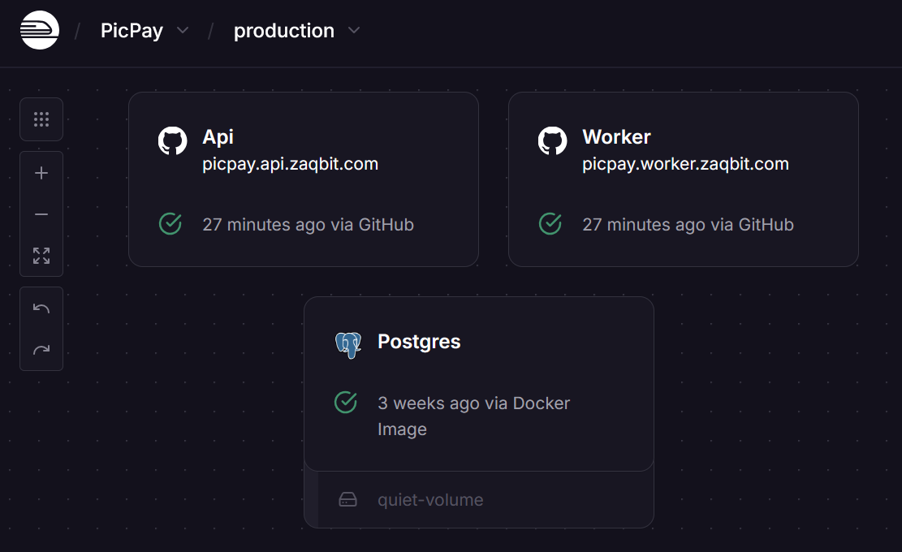

## 7️⃣ Referências

- Repositório original do desafio
    - https://github.com/PicPay/picpay-desafio-backend

- Descomplicando Clean Architecture, DDD e TDD com Desafio PicPay
    - O Nonato faz uma análise excelente dos requisitos e monta casos de uso/teste detalhados
    - https://youtu.be/u-jkRk-kKUM

- Picpay simplificado com Java e Spring Boot!
    - A Giuliana Bezerra desenvolve uma arquitetura robusta, com entrega assícrona das notificações
    - https://youtu.be/YcuscoiIN14

- Resolvendo DESAFIO de VAGA BACKEND com Java Spring
    - https://youtu.be/QXunBiLq2SM

- Desafio PicPay NodeJS
    - https://youtu.be/Y3_ZVg97po0

- Resolvendo DESAFIO BACKEND do PicPay com Java e Spring Boot
    - https://youtu.be/dttXo48oXt4
